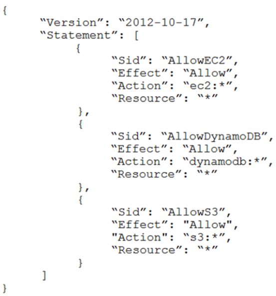
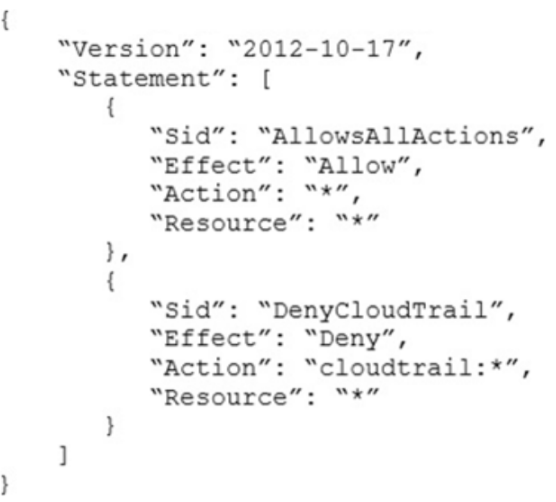

# AWS Solutions Architect Professional

## 1. 问题 #1：混合 DNS 解决方案

一家公司需要构建一个混合 DNS 解决方案。该解决方案将使用 Amazon Route 53 私有托管区域来管理域 `cloud.example.com` 内的资源，这些资源存储在 VPC 中。公司有以下 DNS 解析需求：本地系统应能够解析并连接到 `cloud.example.com`。所有 VPC 都应能够解析 `cloud.example.com`。已经存在一个 AWS Direct Connect 连接在本地企业网络和 AWS Transit Gateway 之间。为了满足这些需求，应使用哪种架构以实现最高性能？

A. 将私有托管区域关联到所有 VPC。在共享服务 VPC 中创建一个 Route 53 入站解析器。将所有 VPC 连接到传输网关，并在本地 DNS 服务器上为 `cloud.example.com` 创建转发规则，指向入站解析器。  
B. 将私有托管区域关联到所有 VPC。在共享服务 VPC 中部署一个 Amazon EC2 条件转发器。将所有 VPC 连接到传输网关，并在本地 DNS 服务器上为 `cloud.example.com` 创建转发规则，指向条件转发器。  
C. 将私有托管区域关联到共享服务 VPC。在共享服务 VPC 中创建一个 Route 53 出站解析器。将所有 VPC 连接到传输网关，并在本地 DNS 服务器上为 `cloud.example.com` 创建转发规则，指向出站解析器。  
D. 将私有托管区域关联到共享服务 VPC。在共享服务 VPC 中创建一个 Route 53 入站解析器。将共享服务 VPC 连接到传输网关，并在本地 DNS 服务器中为 `cloud.example.com` 创建转发规则，指向入站解析器。

## 2. 问题 #2：API 跨区域故障转移

一家公司正在通过基于 REST 的 API 向几个客户提供天气数据。该 API 由 Amazon API Gateway 托管，并为每个 API 操作集成了不同的 AWS Lambda 函数。该公司使用 Amazon Route 53 作为 DNS，并创建了 `weather.example.com` 的资源记录。该公司将 API 的数据存储在 Amazon DynamoDB 表中。该公司需要一个解决方案，使 API 能够故障转移到不同的 AWS 区域。哪个解决方案将满足这些需求？

A. 在新区域部署一组新的 Lambda 函数。更新 API Gateway API 以使用边缘优化的 API 端点，并将两个区域的 Lambda 函数作为目标。将 DynamoDB 表转换为全局表。  
B. 在另一个区域部署一个新的 API Gateway API 和 Lambda 函数。将 Route 53 DNS 记录更改为多值答案。将两个 API Gateway API 添加到答案中。启用目标健康监控。将 DynamoDB 表转换为全局表。  
C. 在另一个区域部署一个新的 API Gateway API 和 Lambda 函数。将 Route 53 DNS 记录更改为故障转移记录。启用目标健康监控。将 DynamoDB 表转换为全局表。  
D. 在新区域部署一个新的 API Gateway API。将 Lambda 函数更改为全局函数。将 Route 53 DNS 记录更改为多值答案。将两个 API Gateway API 添加到答案中。启用目标健康监控。将 DynamoDB 表转换为全局表。

## 3. 问题 #3：Organizations 中的 SCP 与新账户

一家公司使用 AWS Organizations 管理多个账户，其中包含一个名为 `Production` 的单一 OU，用于管理多个账户。所有账户都是 `Production` OU 的成员。管理员使用组织根目录中的拒绝列表 SCP 来管理对受限服务的访问权限。公司最近收购了一个新的业务单元，并将新单元的现有 AWS 账户邀请到组织中。一旦加入，新业务单元的管理员发现他们无法更新现有的 AWS Config 规则以满足公司的政策。哪个选项将允许管理员进行更改，并继续执行当前政策而不引入额外的长期维护？

A. 从组织根目录中移除限制访问 AWS Config 的 SCP。为公司的标准 AWS Config 规则创建 AWS Service Catalog 产品，并在组织中部署它们，包括新账户。  
B. 为新账户创建一个名为 `Onboarding` 的临时 OU。将一个 SCP 应用于 `Onboarding` OU 以允许 AWS Config 操作。调整完 AWS Config 后，将新账户移至 `Production` OU。  
C. 将组织根目录中的 SCP 从拒绝列表 SCP 更改为允许列表 SCP，仅允许所需服务。临时将一个 SCP 应用于组织根目录，以允许新账户中的主体仅进行 AWS Config 操作。  
D. 为新账户创建一个名为 `Onboarding` 的临时 OU。将一个 SCP 应用于 `Onboarding` OU 以允许 AWS Config 操作。将组织根目录的 SCP 移动到 `Production` OU。调整完 AWS Config 后，将新账户移至 `Production` OU。

## 4. 问题 #4：应用程序与数据库层扩展

一家公司正在本地数据中心运行一个两层的基于 Web 的应用程序。应用程序层由一个运行有状态应用程序的单独服务器组成。该应用程序连接到在另一个单独服务器上运行的 PostgreSQL 数据库。预计应用程序的用户基础将显著增长，因此公司正在将应用程序和数据库迁移到 AWS。该解决方案将使用 Amazon Aurora PostgreSQL、Amazon EC2 自动扩展和弹性负载均衡。哪种解决方案将提供一致的用户体验，允许应用程序和数据库层扩展？

A. 为 Aurora 副本启用 Aurora 自动扩展。使用最少未完成请求的路由算法和启用粘性会话的网络负载均衡器。  
B. 为 Aurora 写入者启用 Aurora 自动扩展。使用带有轮询路由算法和启用粘性会话的应用负载均衡器。  
C. 为 Aurora 副本启用 Aurora 自动扩展。使用带有轮询路由算法和启用粘性会话的应用负载均衡器。  
D. 为 Aurora 写入者启用 Aurora 扩展。使用带有最少未完成请求的路由算法和启用粘性会话的网络负载均衡器。

## 5. 问题 #5：为旧设备移除 HTTP 响应头

一家公司使用一项服务来收集在本地托管的应用程序的元数据。这些应用程序被消费设备（如电视和网络收音机）访问。许多旧设备不支持某些 HTTP 头，并且在响应中出现这些头时会出现错误。公司已配置本地负载均衡器，以从发送到旧设备的响应中移除不受支持的头，这些设备是通过 `User-Agent` 头标识的。公司希望将服务迁移到 AWS，采用无服务器技术，并保留支持旧设备的能力。公司已经将应用程序迁移到一组 AWS Lambda 函数中。哪种解决方案将满足这些要求？

A. 为元数据服务创建一个 Amazon CloudFront 分发。创建一个应用程序负载均衡器（ALB）。将 CloudFront 分发配置为转发请求到 ALB。将 ALB 配置为针对每种类型的请求调用正确的 Lambda 函数。创建一个 CloudFront 函数，根据 `User-Agent` 头的值移除问题头。  
B. 为元数据服务创建一个 Amazon API Gateway REST API。将 API Gateway 配置为针对每种类型的请求调用正确的 Lambda 函数。修改默认的网关响应，以根据 `User-Agent` 头的值移除问题头。  
C. 为元数据服务创建一个 Amazon API Gateway HTTP API。将 API Gateway 配置为针对每种类型的请求调用正确的 Lambda 函数。创建一个响应映射模板，以根据 `User-Agent` 的值移除问题头。将响应数据映射与 HTTP API 关联。  
D. 为元数据服务创建一个 Amazon CloudFront 分发。创建一个应用程序负载均衡器（ALB）。将 CloudFront 分发配置为转发请求到 ALB。将 ALB 配置为针对每种类型的请求调用正确的 Lambda 函数。创建一个 Lambda@Edge 函数，根据 `User-Agent` 头的值，在响应用户请求时移除问题头。

## 6. 问题 #7：以无服务器方式运行容器微服务

一家公司正在 Amazon EC2 实例上运行一个传统的 Web 应用程序。公司需要将应用程序重构为在容器上运行的微服务。应用程序在两个不同的环境（生产和测试）中存在不同的版本。应用程序的负载是可变的，但已知最小负载和最大负载。解决方案架构师需要使用无服务器架构设计更新的应用程序，以最小化操作复杂性。哪种解决方案将最符合成本效益？

A. 将容器镜像上传到 AWS Lambda 作为函数。为相关的 Lambda 函数配置并发限制以处理预期的峰值负载。在 Amazon API Gateway 中配置两个单独的 Lambda 集成：一个用于生产环境，一个用于测试环境。  
B. 将容器镜像上传到 Amazon Elastic Container Registry（Amazon ECR）。配置两个自动扩展的 Amazon Elastic Container Service（Amazon ECS）集群，使用 Fargate 启动类型来处理预期的负载。从 ECR 镜像部署任务。配置两个单独的应用负载均衡器将流量定向到 ECS 集群。  
C. 将容器镜像上传到 Amazon Elastic Container Registry（Amazon ECR）。配置两个自动扩展的 Amazon Elastic Kubernetes Service（Amazon EKS）集群，使用 Fargate 启动类型来处理预期的负载。从 ECR 镜像部署任务。配置两个单独的应用负载均衡器将流量定向到 EKS 集群。  
D. 将容器镜像上传到 AWS Elastic Beanstalk。在 Elastic Beanstalk 中为生产和测试环境创建单独的环境和部署。配置两个单独的应用负载均衡器将流量定向到 Elastic Beanstalk 部署。

## 7. 问题 #8：跨区域自动故障转移

一家公司在 Amazon EC2 实例群后运行一个多层 Web 应用程序，这些实例位于一个应用负载均衡器（ALB）后面。实例位于自动扩展组中。ALB 和自动扩展组在备份 AWS 区域复制。自动扩展组的最小值和最大值被设置为零。一个 Amazon RDS Multi-AZ DB 实例存储应用程序的数据。DB 实例在备份区域有一个读取副本。应用程序通过 Amazon Route 53 记录向最终用户提供端点。公司需要将 RTO 减少到 15 分钟以下，通过使应用程序能够自动故障转移到备份区域。解决方案架构师应该推荐什么来满足这些要求？

A. 使用基于延迟的路由策略重新配置应用程序的 Route 53 记录，以在两个 ALB 之间负载均衡流量。在备份区域创建一个 AWS Lambda 函数，以提升读取副本并修改自动扩展组的值。创建一个基于 ALB 的 `HTTPCode_Target_5XX_Count` 指标的 Amazon CloudWatch 警报。配置 CloudWatch 警报以调用 Lambda 函数。  
B. 在备份区域创建一个 AWS Lambda 函数，以提升读取副本并修改自动扩展组的值。使用 Route 53 健康检查监控 Web 应用程序，并将 Amazon Simple Notification Service（Amazon SNS）通知发送到 Lambda 函数，当健康检查状态不正常时。使用故障转移策略更新应用程序的 Route 53 记录，以在健康检查失败时将流量路由到备份区域的 ALB。  
C. 在备份区域将自动扩展组的值设置为与主区域的自动扩展组相同。使用基于延迟的路由策略重新配置应用程序的 Route 53 记录，以在两个 ALB 之间负载均衡流量。移除读取副本。用一个独立的 RDS DB 实例替换读取副本。使用快照和 Amazon S3 配置跨区域复制。  
D. 在 AWS Global Accelerator 中配置一个端点，将两个 ALB 作为等权重目标。在备份区域创建一个 AWS Lambda 函数，以提升读取副本并修改自动扩展组的值。创建一个基于 ALB `HTTPCode_Target_5XX_Count` 指标的 Amazon CloudWatch 警报。配置 CloudWatch 警报以调用 Lambda 函数。

## 8. 问题 #12：通过 PrivateLink 私有访问第三方 SaaS

一家公司想使用第三方软件即服务（SaaS）应用程序。第三方 SaaS 应用程序通过多个 API 调用被使用。第三方 SaaS 应用程序也在 AWS 中的 VPC 上运行。公司将从 VPC 内部使用第三方 SaaS 应用程序。公司有内部安全政策，要求使用不通过互联网的私有连接。不允许从公司 VPC 外部访问在公司 VPC 中运行的任何资源。所有权限必须符合最小权限原则。哪种解决方案满足这些要求？

A. 创建 AWS PrivateLink 接口 VPC 端点。将此端点连接到第三方 SaaS 应用程序提供的端点服务。创建安全组以限制对端点的访问。将安全组与端点关联。  
B. 在第三方 SaaS 应用程序和公司 VPC 之间创建 AWS 站点到站点 VPN 连接。配置网络 ACL 以限制 VPN 隧道之间的访问。  
C. 在第三方 SaaS 应用程序和公司之间创建 VPC 对等连接。更新路由表以添加对等连接所需的路由。  
D. 创建 AWS PrivateLink 端点服务。要求第三方 SaaS 提供商为此端点服务创建接口 VPC 端点。授予特定账户对端点服务的权限。

## 9. 问题 #13：统一服务器补丁管理与报告

一家公司需要为其服务器实施补丁程序。本地服务器和 Amazon EC2 实例使用各种工具执行补丁程序。管理层要求一份报告显示所有服务器和实例的补丁状态。解决方案架构师应该采取哪一套行动来满足这些要求？

A. 使用 AWS Systems Manager 管理本地服务器和 EC2 实例上的补丁程序。使用 Systems Manager 生成补丁合规性报告。  
B. 使用 AWS OpsWorks 管理本地服务器和 EC2 实例上的补丁程序。使用 OpsWorks 与 Amazon QuickSight 集成生成补丁合规性报告。  
C. 使用 Amazon EventBridge 规则通过安排 AWS Systems Manager 补丁修复作业来应用补丁。使用 Amazon Inspector 生成补丁合规性报告。  
D. 使用 AWS OpsWorks 管理本地服务器和 EC2 实例上的补丁程序。使用 AWS X-Ray 将补丁状态发布到 AWS Systems Manager OpsCenter 以生成补丁合规性报告。

## 10. 问题 #14：实例终止前可靠复制日志

一家公司在自动扩展组中的几个 Amazon EC2 实例上运行应用程序。应用程序的负载在一天中变化，EC2 实例定期进行扩展和缩减。每 15 分钟将来自 EC2 实例的日志文件复制到一个中央 Amazon S3 存储桶。安全团队发现，一些终止的 EC2 实例的日志文件丢失了。为了确保从终止的 EC2 实例复制日志文件到中央 S3 存储桶，将采取哪一套行动？

A. 创建一个脚本将日志文件复制到 Amazon S3，并在 EC2 实例上存储该脚本。创建一个自动扩展生命周期挂钩和一个 Amazon EventBridge 规则以检测自动扩展组的生命周期事件。在 `EC2_INSTANCE_TERMINATING` 转换时调用 AWS Lambda 函数，向自动扩展组发送 `ABANDON` 以防止终止，运行脚本复制日志文件，并使用 AWS SDK 终止实例。  
B. 创建一个带有复制日志文件到 Amazon S3 的脚本的 AWS Systems Manager 文档。创建一个自动扩展生命周期挂钩和一个 Amazon EventBridge 规则以检测自动扩展组的生命周期事件。在 `EC2_INSTANCE_TERMINATING` 转换时调用 AWS Lambda 函数，使用 AWS Systems Manager API `SendCommand` 操作运行文档以复制日志文件，并向自动扩展组发送 `CONTINUE` 以终止实例。  
C. 将日志传递速率更改为每 5 分钟。创建一个脚本将日志文件复制到 Amazon S3，并在 EC2 实例用户数据中添加该脚本。创建一个 Amazon EventBridge 规则以检测 EC2 实例终止。从 EventBridge 规则调用 AWS Lambda 函数，使用 AWS CLI 运行用户数据脚本以复制日志文件并终止实例。  
D. 创建一个带有复制日志文件到 Amazon S3 的脚本的 AWS Systems Manager 文档。创建一个自动扩展生命周期挂钩，该挂钩向 Amazon Simple Notification Service（Amazon SNS）主题发布消息。从 SNS 通知中，调用 AWS Systems Manager API `SendCommand` 操作运行文档以复制日志文件，并发送 `ABANDON` 到自动扩展组以终止实例。

## 11. 问题 #16：扩展博客网站的视频内容分发

一家公司使用 Amazon EC2 实例部署了一个托管博客网站的 Web 集群。EC2 实例位于应用程序负载均衡器（ALB）后面，并配置在自动扩展组中。该网站应用程序将所有博客内容存储在 Amazon EFS 卷上。该公司最近为博主添加了一个在帖子中添加视频的功能，吸引了之前 10 倍的用户流量。在一天的高峰时段，用户报告在尝试访问网站或观看视频时出现缓冲和超时问题。哪种是最具有成本效益和可扩展性的部署，可以解决用户的这些问题？

A. 重新配置 Amazon EFS 以启用最大 I/O。  
B. 更新博客网站以使用实例存储卷进行存储。在启动时将网站内容复制到卷中，并在关闭时复制到 Amazon S3。  
C. 配置 Amazon CloudFront 分发到指向 S3 存储桶的分发，并迁移 EFS 中的视频到 Amazon S3。  
D. 为所有网站内容设置 Amazon CloudFront 分发，并指向 ALB。

## 12. 问题 #17：冗余 Direct Connect 与跨区域访问

一家公司有一个单一的 1 Gbps AWS Direct Connect 连接到单一的 AWS Region。公司的本地网络使用该连接与 AWS 云中的资源进行通信。该连接有一个单一的私有虚拟接口，连接到单一的 VPC。解决方案架构师必须实施一个解决方案，以在同一 Region 中添加一个冗余的 Direct Connect 连接。该解决方案还必须通过同一对 Direct Connect 连接提供连接到其他 Region 的访问，因为公司扩展到其他 Region。哪种解决方案满足这些要求？

A. 配置 Direct Connect 网关。删除现有连接中的现有私有虚拟接口。创建第二个 Direct Connect 连接。在每个连接上创建一个新的私有虚拟接口，并将两个私有虚拟接口连接到 Direct Connect 网关。将 Direct Connect 网关连接到单一的 VPC。  
B. 保留现有的私有虚拟接口。创建第二个 Direct Connect 连接。在新连接上创建一个新的私有虚拟接口，并将新的私有虚拟接口连接到单一的 VPC。  
C. 保留现有的私有虚拟接口。创建第二个 Direct Connect 连接。在新连接上创建一个新的公共虚拟接口，并将新的公共虚拟接口连接到单一的 VPC。  
D. 配置一个传输网关。从现有连接中删除现有的私有虚拟接口。创建第二个 Direct Connect 连接。在每个连接上创建一个新的私有虚拟接口，并将两个私有虚拟接口连接到传输网关。将传输网关与单一的 VPC 关联。

## 13. 问题 #18：使用托管服务处理视频

一家公司有一个允许用户上传短视频的 Web 应用程序。视频存储在 Amazon EBS 卷上，并由自定义识别软件分析以进行分类。该网站包含具有某些月份高峰的可变流量的静态内容。该架构由运行在自动扩展组中的 Amazon EC2 实例组成的 Web 应用程序和处理 Amazon SQS 队列的 EC2 实例组成。公司希望重新构建应用程序，以使用 AWS 托管服务尽可能减少运营开销，并消除对第三方软件的依赖。哪种解决方案满足这些要求？

A. 使用 Amazon ECS 容器运行 Web 应用程序。使用 Spot 实例为处理 SQS 队列的自动扩展组。用 Amazon Rekognition 替换自定义软件来对视频进行分类。  
B. 将上传的视频存储在 Amazon EFS 中，并挂载文件系统到 Web 应用程序的 EC2 实例。使用 AWS Lambda 函数处理 SQS 队列，调用 Amazon Rekognition API 对视频进行分类。  
C. 在 Amazon S3 中托管 Web 应用程序。将上传的视频存储在 Amazon S3 中。使用 S3 事件通知发布事件到 SQS 队列。使用 AWS Lambda 函数处理 SQS 队列，调用 Amazon Rekognition API 对视频进行分类。  
D. 使用 AWS Elastic Beanstalk 启动 EC2 实例的 Web 应用程序和工作环境，以处理 SQS 队列。用 Amazon Rekognition 替换自定义软件来对视频进行分类。

## 14. 问题 #19：Lambda 金丝雀部署与快速回滚

一家公司拥有一个由 Amazon CloudFront、Amazon API Gateway 和 AWS Lambda 函数组成的无服务器应用程序。当前的部署过程是为 Lambda 函数创建一个新版本号，并运行一个 AWS CLI 脚本来更新。如果新函数版本有错误，另一个 CLI 脚本来部署以前的工作版本。公司希望减少部署新版本的应用程序逻辑所需的时间，并在发现错误时减少检测和回滚的时间。如何实现这一目标？

A. 创建并部署具有父堆栈的嵌套 AWS CloudFormation 堆栈，父堆栈由 AWS CloudFront 分发和 API Gateway 组成，子堆栈包含 Lambda 函数。对于 Lambda 的更改，创建 AWS CloudFormation 更改集并部署；如果触发错误，回滚到以前的版本。  
B. 使用 AWS SAM 和内置的 AWS CodeDeploy 部署新版本的 Lambda，逐步将流量转移到新版本，并使用流量前后测试功能验证代码。如果 Amazon CloudWatch 警报触发，则回滚。  
C. 将 AWS CLI 脚本重构为一个单一脚本，部署新版本的 Lambda。部署完成后，执行测试脚本。如果检测到错误，则回滚到以前的 Lambda 版本。  
D. 创建并部署一个 AWS CloudFormation 堆栈，其中包含一个新的 API Gateway 端点，引用新的 Lambda 版本。将 CloudFront 源站更改为新的 API Gateway 端点，监控错误，如果检测到错误，则将 AWS CloudFront 源站更改为以前的 API Gateway 端点。

## 15. 问题 #20：低成本私有归档存储

一家公司计划将大量存档文件存储在 AWS 上，并通过公司内部网使员工能够访问这些文件。员工将通过连接到 VPC 的客户端 VPN 服务来访问该系统。数据不得对公众可访问。公司存储的文件是存储在其他地方物理媒体上的数据副本。请求的数量将很低。可用性和检索速度不是公司的担忧。哪种解决方案将以最低成本满足这些要求？

A. 创建一个 Amazon S3 存储桶。将 S3 存储桶配置为使用 S3 One Zone-Infrequent Access（S3 One Zone-IA）存储类别作为默认值。将 S3 存储桶配置为网站托管。创建一个 S3 接口端点。配置 S3 存储桶仅允许通过该端点访问。  
B. 启动一个运行 Web 服务器的 Amazon EC2 实例。附加一个 Amazon Elastic File System（Amazon EFS）文件系统以存储归档数据，在 EFS One Zone-Infrequent Access（EFS One Zone-IA）存储类别中。配置实例安全组仅允许从私有网络访问。  
C. 启动一个运行 Web 服务器的 Amazon EC2 实例。附加一个 Amazon Elastic Block Store（Amazon EBS）卷以存储归档数据。使用 Cold HDD（sc1）卷类型。配置实例安全组仅允许从私有网络访问。  
D. 创建一个 Amazon S3 存储桶。将 S3 存储桶配置为使用 S3 Glacier Deep Archive 存储类别作为默认值。将 S3 存储桶配置为网站托管。创建一个 S3 接口端点。配置 S3 存储桶仅允许通过该端点访问。

## 16. 问题 #21：使用本地 Active Directory 进行 AWS 账户访问

一家公司使用本地 Active Directory 服务进行用户认证。公司希望使用相同的认证服务登录到使用 AWS Organizations 的公司 AWS 账户。AWS 站点到站点 VPN 连接已经在本地环境和公司的所有 AWS 账户之间建立。公司的安全政策要求根据用户组和角色进行有条件的访问。用户身份必须在单个位置管理。哪种解决方案将满足这些要求？

A. 配置 AWS IAM Identity Center（AWS Single Sign-On），使用 SAML 2.0 连接到 Active Directory。使用跨域身份管理（SCIM）v2.0 协议启用自动预置。使用基于属性的访问控制（ABAC）授予对 AWS 账户的访问权限。  
B. 通过使用 IAM Identity Center 作为身份来源配置 AWS IAM Identity Center。使用跨域身份管理（SCIM）v2.0 协议启用自动预置。使用 IAM Identity Center 权限集授予对 AWS 账户的访问权限。  
C. 在公司的 AWS 账户中，配置 AWS 身份和访问管理（IAM）以使用 SAML 2.0 身份提供者。预置映射到联合用户的 IAM 用户。授予对应于 Active Directory 中的适当组的访问权限。使用跨账户 IAM 用户授予对所需 AWS 账户的访问权限。  
D. 在公司的 AWS 账户中，配置 AWS 身份和访问管理（IAM）以使用 OpenID Connect（OIDC）身份提供者。预置 IAM 角色，以授予对应于 Active Directory 中的适当组的联合用户访问 AWS 账户的权限。使用跨账户 IAM 角色授予对所需 AWS 账户的访问权限。

## 17. 问题 #22：API Gateway PUT 请求错误

一家软件公司已部署一个应用程序，该应用程序使用 Amazon API Gateway 的 REST API、AWS Lambda 函数和 Amazon DynamoDB 表。该应用程序在 PUT 请求期间显示出增加的错误数量。大多数 PUT 调用来自几个使用特定 API 密钥进行身份验证的客户端。大量 PUT 请求来自一个客户端。该 API 不是关键的，客户端可以容忍不成功的调用重试。但是，错误会显示给客户，并正在损害 API 的声誉。解决方案架构师应该推荐什么来改善客户体验？

A. 在客户端应用程序中实现带有指数退避和随机抖动的重试逻辑。确保捕获错误并处理具有描述性错误消息。  
B. 通过 API Gateway 级别的使用计划实现 API 限速。确保客户端应用程序在收到代码 429 回复时不会出错。  
C. 打开 API 缓存以提高生产阶段的响应能力。运行 10 分钟的负载测试。验证缓存容量是否适合工作负载。  
D. 在 Lambda 函数级别实现保留并发，以在流量突然增加时提供所需的资源。

## 18. 问题 #23：按需高性能共享文件系统

一家公司在 AWS 上运行一个数据密集型应用程序。该应用程序在数百个 Amazon EC2 实例上运行。一个共享文件系统也在几个 EC2 实例上运行，存储了 200 TB 的数据。应用程序读取并修改共享文件系统上的数据，并生成报告。该工作每月运行一次，读取文件系统的子集，并需要大约 72 小时才能完成。计算实例在自动扩展组中进行扩展，但托管共享文件系统的实例持续运行。计算和存储实例都位于同一 AWS Region。解决方案架构师需要通过替换共享文件系统实例来降低成本。文件系统必须在 72 小时运行期间为所需的数据提供高性能访问。哪种解决方案将在满足这些要求的同时提供最大的总体成本节约？

A. 将数据从现有的共享文件系统迁移到使用 S3 Intelligent-Tiering 存储类别的 Amazon S3 存储桶。在每月工作运行之前，使用 Amazon FSx for Lustre 通过懒加载从 Amazon S3 创建一个新的文件系统。使用新文件系统作为共享存储，持续工作期间。工作完成后删除文件系统。  
B. 将数据从现有的共享文件系统迁移到启用 Multi-Attach 的较大 Amazon Elastic Block Store（Amazon EBS）卷。使用自动扩展组启动模板中的用户数据脚本将 EBS 卷附加到每个实例。在工作期间使用 EBS 卷作为共享存储。工作完成后分离 EBS 卷。  
C. 将数据从现有的共享文件系统迁移到使用 S3 Standard 存储类别的 Amazon S3 存储桶。在每月工作运行之前，使用 Amazon FSx for Lustre 通过批量加载从 Amazon S3 创建一个新的文件系统。使用新文件系统作为共享存储，持续工作期间。工作完成后删除文件系统。  
D. 将数据从现有的共享文件系统迁移到 Amazon S3 存储桶。在每月工作运行之前，使用 AWS Storage Gateway 从 Amazon S3 创建一个文件网关。使用文件网关作为工作期间的共享存储。工作完成后删除文件网关。

## 19. 问题 #24：固定 IP 的高可用 TCP 服务

一家公司正在开发一项新服务，该服务将使用 TCP 在静态端口上进行访问。服务必须是高可用的，跨可用区具有冗余，并且可以使用 DNS 名称 `my.service.com` 公开访问，该名称必须是公开可访问的。服务必须使用固定地址分配，以便其他公司可以将地址添加到其允许列表中。假设资源部署在单个 Region 中的多个可用区，哪种解决方案将满足这些要求？

A. 为每个实例创建带有弹性 IP 地址的 Amazon EC2 实例。创建一个网络负载均衡器（NLB）并暴露静态 TCP 端口。将 EC2 实例注册到 NLB。为 `my.service.com` 创建一个新的名称服务器记录集，并将 EC2 实例的弹性 IP 地址分配给记录集。将 EC2 实例的弹性 IP 地址提供给其他公司以添加到其允许列表中。  
B. 为应用程序创建一个 Amazon ECS 集群和服务定义。为 ECS 集群分配公共 IP 地址。创建一个网络负载均衡器（NLB）并暴露 TCP 端口。创建一个目标组，并将 ECS 集群名称分配给 NLB。为 `my.service.com` 创建一个新的 A 记录集，并将 ECS 集群的公共 IP 地址分配给记录集。将 ECS 集群的公共 IP 地址提供给其他公司以添加到其允许列表中。  
C. 为服务创建 Amazon EC2 实例。为每个可用区创建一个弹性 IP 地址。创建一个网络负载均衡器（NLB）并暴露分配的 TCP 端口。将弹性 IP 地址分配给每个可用区的 NLB。创建一个目标组，并将 EC2 实例注册到 NLB。为 `my.service.com` 创建一个新的 A（别名）记录集，并将 NLB 的 DNS 名称分配给记录集。  
D. 为应用程序创建一个 Amazon ECS 集群和服务定义。为集群中的每个主机分配公共 IP 地址。创建一个应用负载均衡器（ALB）并暴露静态 TCP 端口。创建一个目标组，并将 ECS 服务定义名称分配给 ALB。为公共 IP 地址创建一个新的 CNAME 记录集。将 Amazon EC2 实例的弹性 IP 地址提供给其他公司以添加到其允许列表中。

## 20. 问题 #25：具有 SLA 的批处理任务与 Spot 实例

一家公司在本地数据中心使用高度可用的配置在 12 台服务器上运行一个数据分析平台。该系统运行计划任务，包括每小时和每天的任务，以及用户一次性请求。计划任务可能需要 20 分钟到 2 小时才能完成，并且有严格的服务级别协议（SLA）。计划任务占系统使用量的 65%。用户任务通常在不到 5 分钟内完成，并且没有 SLA。用户任务占系统使用量的 35%。在系统故障期间，计划任务必须继续满足 SLA。但是，用户任务可能会被延迟。解决方案架构师需要将系统迁移到 Amazon EC2 实例，并采用按消费付费的模式以降低成本，而无需长期承诺。解决方案必须保持高可用性，并且不得影响 SLA。哪种解决方案将以最具成本效益的方式满足这些要求？

A. 将 12 个实例分布在所选 AWS Region 的两个可用区中。在每个可用区运行两个实例作为具有容量预留的按需实例。在每个可用区运行四个实例作为现货实例。  
B. 将 12 个实例分布在所选 AWS Region 的三个可用区中。在一个可用区运行所有四个实例作为具有容量预留的按需实例。其余实例作为现货实例运行。  
C. 将 12 个实例分布在所选 AWS Region 的三个可用区中。在每个可用区运行两个实例作为具有储蓄计划的按需实例。  
D. 将 12 个实例分布在所选 AWS Region 的三个可用区中。在每个可用区运行三个实例作为具有容量预留的按需实例。在每个可用区运行一个实例作为现货实例。

## 21. 问题 #26：每 90 天轮换数据库凭据

一位安全工程师确定，一个现有应用程序从 Amazon S3 中的加密文件中检索 Amazon RDS for MySQL 数据库的凭据。对于应用程序的下一个版本，安全工程师希望实现以下应用程序设计变更以提高安全性：数据库必须使用强有力、随机生成的密码，并存储在安全的 AWS 托管服务中。应用程序资源必须通过 AWS CloudFormation 部署。应用程序必须每 90 天轮换一次数据库凭据。解决方案架构师将生成一个 CloudFormation 模板来部署应用程序。为了以最少的操作开销满足安全工程师的要求，解决方案架构师应该在 CloudFormation 模板中指定哪些资源？

A. 使用 AWS Secrets Manager 作为秘密资源生成数据库密码。创建一个 AWS Lambda 函数资源来轮换数据库密码。指定一个 Secrets Manager 轮换计划资源，每 90 天轮换一次数据库密码。  
B. 使用 AWS Systems Manager 参数存储作为 SecureString 参数类型生成数据库密码。创建一个 AWS Lambda 函数资源来轮换数据库密码。指定一个参数存储轮换计划资源，每 90 天轮换一次数据库密码。  
C. 使用 AWS Secrets Manager 作为秘密资源生成数据库密码。创建一个 AWS Lambda 函数资源来轮换数据库密码。创建一个 Amazon EventBridge 定时规则资源，每 90 天触发一次 Lambda 函数密码轮换。  
D. 使用 AWS Systems Manager 参数存储作为 SecureString 参数类型生成数据库密码。指定 AWS AppSync 数据源资源，每 90 天自动轮换数据库密码。

## 22. 问题 #29：准确计算合规工具的成本

一家使用 AWS Organizations 管理多个 AWS 账户的公司拥有 VPC、Amazon EC2 实例和容器。公司的合规团队在每个部署了 VPC 的账户中部署了一个安全工具。安全工具在 EC2 实例上运行，并将信息发送到专门用于合规团队的 AWS 账户。公司已经使用 `costCenter` 作为标签键，并将 `compliance` 作为标签值标记了所有与合规相关的资源。公司希望识别运行在 EC2 实例上的安全工具的成本，以便公司可以向合规团队的 AWS 账户收费。成本计算必须尽可能准确。解决方案架构师应该采取哪些措施来满足这些要求？

A. 在组织的管理账户中激活 `costCenter` 用户定义标签。配置每月 AWS 成本和使用情况报告保存到管理账户中的 Amazon S3 存储桶。使用报告中的标签细分来获取标记为 `costCenter` 的资源的总成本。  
B. 在组织的成员账户中激活 `costCenter` 用户定义标签。配置每月 AWS 成本和使用情况报告保存到管理账户中的 Amazon S3 存储桶。安排每月 AWS Lambda 函数检索报告并计算标记为 `costCenter` 的资源的总成本。  
C. 在组织的成员账户中激活 `costCenter` 用户定义标签。从管理账户调度每月 AWS 成本和使用情况报告。使用报告中的标签细分来计算标记为 `costCenter` 的资源的总成本。  
D. 在组织视图中创建 AWS Trusted Advisor 的自定义报告。配置报告生成每月账单摘要，用于合规团队的 AWS 账户中标记为 `costCenter` 的资源。

## 23. 问题 #31：限制 Private Marketplace 管理权限

一个企业公司希望允许其开发人员通过 AWS Marketplace 购买第三方软件。公司使用具有完整功能的 AWS Organizations 账户结构，并在每个组织单元（OU）中都有一个共享服务账户，这些账户将被采购经理使用。采购团队的政策表明，开发人员应该只能从批准的列表中获取第三方软件，并使用 AWS Marketplace 中的 Private Marketplace 来实现这一要求。采购团队希望将 Private Marketplace 的管理权限限制为名为 `procurement-manager-role` 的角色，这个角色可以被采购经理假定。公司中的其他 IAM 用户、组、角色和账户管理员应该被拒绝 Private Marketplace 的管理访问权限。最高效的架构设计方式是什么？

A. 在组织的所有 AWS 账户中创建名为 `procurement-manager-role` 的 IAM 角色。向角色添加 Power User Access 管理策略。在每个 AWS 账户的所有 IAM 用户和角色上应用一个内联策略，以拒绝 AWS Private Marketplace Admin Full Access 管理策略的权限。  
B. 在组织的所有 AWS 账户中创建名为 `procurement-manager-role` 的 IAM 角色。向角色添加 Administrator Access 管理策略。定义一个权限边界，使用 AWS Private Marketplace Admin Full Access 管理策略，并将其附加到所有开发人员角色。  
C. 在组织的所有共享服务账户中创建名为 `procurement-manager-role` 的 IAM 角色。向角色添加 AWS Private Marketplace Admin Full Access 管理策略。在组织根级别创建一个 SCP，以拒绝除名为 `procurement-manager-role` 的角色之外的所有人管理 Private Marketplace 的权限。创建另一个组织根级别的 SCP，以禁止组织中的所有人创建名为 `procurement-manager-role` 的 IAM 角色。  
D. 在所有由开发人员使用的 AWS 账户中创建名为 `procurement-manager-role` 的 IAM 角色。向角色添加 AWS Private Marketplace Admin Full Access 管理策略。在组织中创建一个 SCP，以拒绝除名为 `procurement-manager-role` 的角色之外的所有人管理 Private Marketplace 的权限。将 SCP 应用于组织中的所有共享服务账户。

## 24. 问题 #32：使用 SCP 限制 AWS 服务

一家公司正在实施 AWS Organizations 来限制其开发人员仅使用 Amazon EC2、Amazon S3 和 Amazon DynamoDB。开发人员账户位于专用的组织单元（OU）。解决方案架构师在此开发人员账户上实施了以下 SCP：当此策略部署后，开发人员账户中的 IAM 用户仍然能够使用不在策略中列出的 AWS 服务。解决方案架构师应该采取什么措施来消除开发人员使用此策略范围之外服务的能力？

A. 为每个应受限制的 AWS 服务创建显式的拒绝声明。  
B. 从开发人员账户的 OU 中移除 `FullAWSAccess` SCP。  
C. 修改 `FullAWSAccess` SCP 以明确拒绝所有服务。  
D. 在 SCP 的末尾添加一个使用通配符的显式拒绝声明。

## 25. 问题 #33：处理 API 流量突增

一家公司在公共子网的 VPC 中托管了一个单体 REST 基础 API，用于移动应用程序。移动客户端通过 Amazon Route 53 上托管的域名连接到 API。该公司为所有 EC2 实例的 IP 地址创建了一个 Route 53 多值答案路由策略。最近，应用程序因流量突然大幅增加而不堪重负。解决方案架构师需要实施一个解决方案，以便应用程序能够处理新的和不断变化的负载。哪种解决方案能满足这些要求，同时操作开销最小？

A. 将 API 分离成单独的 AWS Lambda 函数。为后端配置 Amazon API Gateway REST API 与 Lambda 集成。更新 Route 53 记录，指向 API Gateway API。  
B. 将 API 容器化。创建 Amazon Elastic Kubernetes Service（Amazon EKS）集群。使用 Amazon EC2 运行集群中的容器。创建 Kubernetes 入口。更新 Route 53 记录，指向 Kubernetes 入口。  
C. 创建 Auto Scaling 组。将所有 EC2 实例放入 Auto Scaling 组中。配置 Auto Scaling 组根据 CPU 使用率执行扩展操作。创建 AWS Lambda 函数，响应 Auto Scaling 组变更并更新 Route 53 记录。  
D. 在 API 前创建一个应用负载均衡器（ALB）。将 EC2 实例移动到 VPC 中的私有子网。将 EC2 实例添加为 ALB 的目标。更新 Route 53 记录，指向 ALB。

## 26. 问题 #34：按 OU 查看成本细分

一家公司为每个工程团队创建了 AWS 组织中的 OU。每个 OU 拥有多个 AWS 账户。该公司拥有数百个 AWS 账户。解决方案架构师必须设计一个解决方案，以便每个 OU 可以查看其 AWS 账户的使用成本细分。哪种解决方案满足这些要求？

A. 使用 AWS 资源访问管理器为每个 OU 创建 AWS 成本和使用情况报告（CUR）。允许每个团队通过 Amazon QuickSight 仪表板可视化 CUR。  
B. 从 AWS 组织管理账户创建 AWS 成本和使用情况报告（CUR）。允许每个团队通过 Amazon QuickSight 仪表板可视化 CUR。  
C. 在每个 AWS 组织成员账户中创建 AWS 成本和使用情况报告（CUR）。允许每个团队通过 Amazon QuickSight 仪表板可视化 CUR。  
D. 使用 AWS Systems Manager 创建 AWS 成本和使用情况报告（CUR）。允许每个团队通过 Systems Manager OpsCenter 仪表板可视化 CUR。

## 27. 问题 #35：将本地 Windows 文件复制到 AWS

一家公司在本地存储数据在基于 Windows 的文件服务器上。该公司每天产生 5 GB 的新数据。公司已将部分基于 Windows 的工作负载迁移到 AWS，并需要在云端的文件系统中使数据可用。公司已经在本地网络和 AWS 之间建立了 AWS Direct Connect 连接。公司应使用哪种数据迁移策略？

A. 使用 AWS Storage Gateway 中的文件网关选项替换现有的 Windows 文件服务器，并指向新的文件网关。  
B. 使用 AWS DataSync 安排每日任务，在本地 Windows 文件服务器和 Amazon FSx 之间复制数据。  
C. 使用 AWS Data Pipeline 安排每日任务，在本地 Windows 文件服务器和 Amazon Elastic File System（Amazon EFS）之间复制数据。  
D. 使用 AWS DataSync 安排每日任务，在本地 Windows 文件服务器和 Amazon Elastic File System（Amazon EFS）之间复制数据。

## 28. 问题 #36：静态 S3 资源的多区域弹性

公司的解决方案架构师正在审查一个在 AWS 上运行的 Web 应用程序。该应用程序引用了 `us-east-1` Region 中的 Amazon S3 存储桶中的静态资源。公司需要在多个 AWS Region 中实现弹性。公司已经在第二个 Region 中创建了一个 S3 存储桶。哪种解决方案将以最小的运营开销满足这些要求？

A. 配置应用程序以同时写入两个 S3 存储桶。为每个 S3 存储桶设置 Amazon Route 53 公共托管区域，并使用加权路由策略。配置应用程序使用 Route 53 DNS 名称引用对象。  
B. 创建一个 AWS Lambda 函数，从 `us-east-1` 中的 S3 存储桶复制对象到第二个 Region 中的 S3 存储桶。每次向 `us-east-1` 中的 S3 存储桶写入对象时，调用 Lambda 函数。设置一个 Amazon CloudFront 分发，其中包含两个 S3 存储桶作为来源的来源组。  
C. 配置 `us-east-1` 中的 S3 存储桶的复制，将对象复制到第二个 Region 中的 S3 存储桶。设置一个包含两个 S3 存储桶作为来源的来源组的 Amazon CloudFront 分发。  
D. 配置 `us-east-1` 中的 S3 存储桶的复制，将对象复制到第二个 Region 中的 S3 存储桶。如果需要故障转移，更新应用程序代码以从第二个 Region 中的 S3 存储桶加载 S3 对象。

## 29. 问题 #37：可扩展且高可用的三层 Web 应用

一家公司在本地环境中托管了一个三层 Web 应用程序。由于最近流量激增导致停机和重大的经济损失，公司管理层已下令将应用程序迁移到 AWS。该应用程序使用 .NET 编写，并依赖于 MySQL 数据库。解决方案架构师必须设计一个可扩展和高可用的解决方案，以满足 200,000 日常用户的需求。解决方案架构师应采取哪些步骤来设计适当的解决方案？

A. 使用 AWS Elastic Beanstalk 创建一个新的应用程序，使用 Web 服务器环境和 Amazon RDS MySQL 多可用区（Multi-AZ）数据库实例。环境应在多个可用区前启动一个网络负载均衡器（NLB）。使用 Amazon Route 53 别名记录将公司域名的流量路由到 NLB。  
B. 使用 AWS CloudFormation 启动一个堆栈，其中包含一个应用程序负载均衡器（ALB），在三个可用区前启动一个 Amazon EC2 自动扩展组。堆栈应启动一个 Amazon Aurora MySQL 数据库集群的多可用区部署，并保留删除策略。使用 Amazon Route 53 别名记录将公司域名的流量路由到 ALB。  
C. 使用 AWS Elastic Beanstalk 创建一个自动扩展的 Web 服务器环境，跨越两个单独的区域，并在每个区域中都有一个应用程序负载均衡器（ALB）。创建一个 Amazon Aurora MySQL 数据库集群的多可用区部署，并创建跨区域读取副本。使用 Amazon Route 53 的地理接近性路由策略在两个区域之间路由流量。  
D. 使用 AWS CloudFormation 启动一个堆栈，其中包含一个应用程序负载均衡器（ALB），在三个可用区前启动一个 Amazon ECS 集群的 Spot 实例。堆栈应启动一个带有快照删除策略的 Amazon RDS MySQL 数据库实例。使用 Amazon Route 53 别名记录将公司域名的流量路由到 ALB。

## 30. 问题 #38：通过 StackSets 部署到组织账户

一家公司使用 AWS Organizations 来管理多个 AWS 账户。出于安全原因，公司需要在所有组织成员账户中创建一个 Amazon Simple Notification Service（Amazon SNS）主题，以实现与第三方警报系统的集成。解决方案架构师使用 AWS CloudFormation 模板创建 SNS 主题，并使用堆栈集来自动化 CloudFormation 堆栈的部署。已在组织中启用了信任访问。解决方案架构师应如何部署 CloudFormation StackSets 以覆盖所有 AWS 账户？

A. 在组织成员账户中创建堆栈集。使用服务管理权限。将部署选项设置为部署到组织。使用 CloudFormation StackSets 漂移检测。  
B. 在组织成员账户中创建堆栈。使用自助服务权限。将部署选项设置为部署到组织。  
C. 在组织管理账户中创建堆栈集。使用服务管理权限。将部署选项设置为部署到组织。启用 CloudFormation StackSets 自动部署。  
D. 在组织管理账户中创建堆栈。使用服务管理权限。将部署选项设置为部署到组织。启用 CloudFormation StackSets 漂移检测。

## 31. 问题 #40：降低 S3 访问的数据传输成本

一家公司在 AWS VPC 中托管了一个图像处理服务。VPC 横跨两个可用区。每个可用区包含一个公共子网和一个私有子网。服务在私有子网中的 Amazon EC2 实例上运行。公共子网中有一个应用程序负载均衡器（ALB）在服务前面。服务需要通过两个 NAT 网关与互联网通信。服务使用 Amazon S3 进行图像存储。EC2 实例每天从 S3 存储桶中检索大约 1 TB 的数据。公司已将服务推广为高度安全。解决方案架构师必须在不降低服务的安全性或增加持续运营时间的情况下尽可能减少云支出。哪种解决方案满足这些要求？

A. 用 NAT 实例替换 NAT 网关。  
B. 将 EC2 实例移动到公共子网。删除 NAT 网关。  
C. 在 VPC 中设置 S3 网关 VPC 端点。将端点策略附加到端点，以允许在 S3 存储桶上执行所需的操作。  
D. 将 Amazon Elastic File System（Amazon EFS）卷附加到 EC2 实例。在 EFS 卷上托管图像。

## 32. 问题 #41：优化 DynamoDB 表成本

一家公司最近在 AWS 上部署了一个应用程序。该应用程序使用 Amazon DynamoDB。公司测量了应用程序负载，并配置了 DynamoDB 表的 RCU 和 WCU 以匹配预期的峰值负载。峰值负载每周发生一次，持续 4 小时，是平均负载的两倍。应用程序负载在一周的其余时间里接近平均负载。访问模式包括对表的写入操作比读取操作多得多。解决方案架构师需要实施一种解决方案，以最小化表的成本。哪种解决方案满足这些要求？

A. 使用 AWS Application Auto Scaling 来增加高峰期间的容量。购买与平均负载相匹配的预留 RCU 和 WCU。  
B. 为表配置按需容量模式。  
C. 在表前配置 DynamoDB 加速器（DAX）。将预留读取容量减少以匹配表上的新峰值负载。  
D. 在表前配置 DynamoDB 加速器（DAX）。为表配置按需容量模式。

## 33. 问题 #42：以低成本处理长时间运行的媒体文件

解决方案架构师需要就如何将公司的本地数据处理应用程序迁移到 AWS 云提供建议。目前，用户通过 Web 门户上传输入文件。Web 服务器随后将上传的文件存储在 NAS 上，并通过消息队列向处理服务器发送消息。每个媒体文件的处理时间可达 1 小时。公司已确定，在工作时间，等待处理的媒体文件数量显著增加，而在工作时间之后，文件数量迅速下降。什么是最具成本效益的迁移建议？

A. 使用 Amazon SQS 创建队列。配置现有 Web 服务器发布到新队列。当队列中有消息时，调用 AWS Lambda 函数从队列中拉取请求并处理文件。将处理过的文件存储在 Amazon S3 存储桶中。  
B. 使用 Amazon MQ 创建队列。配置现有 Web 服务器发布到新队列。当队列中有消息时，创建一个新的 Amazon EC2 实例，从队列中拉取请求并处理文件。将处理过的文件存储在 Amazon EFS 中。任务完成后关闭 EC2 实例。  
C. 使用 Amazon MQ 创建队列。配置现有 Web 服务器发布到新队列。当队列中有消息时，调用 AWS Lambda 函数从队列中拉取请求并处理文件。将处理过的文件存储在 Amazon EFS 中。  
D. 使用 Amazon SQS 创建队列。配置现有 Web 服务器发布到新队列。使用 Amazon EC2 实例在 EC2 自动扩展组中从队列中拉取请求并处理文件。根据 SQS 队列长度扩展 EC2 实例。将处理过的文件存储在 Amazon S3 存储桶中。

## 34. 问题 #43：降低 OpenSearch Service 的持续成本

一家公司正在使用 Amazon OpenSearch Service 来分析数据。公司从使用 S3 Standard 存储的 Amazon S3 存储桶中加载数据到 OpenSearch Service 集群的 10 个数据节点中。数据在集群中保留 1 个月，用于只读分析。1 个月后，公司会从集群中删除包含数据的索引。为了遵守规定，公司必须保留所有输入数据的副本。公司对持续成本表示担忧，并向解决方案架构师询问了一种新的解决方案。哪种解决方案最具成本效益？

A. 将所有数据节点替换为 UltraWarm 节点以处理预期的容量。将输入数据从 S3 Standard 迁移到 S3 Glacier Deep Archive，当公司将数据加载到集群中时。  
B. 将集群中的数据节点数量减少到 2。添加 UltraWarm 节点以处理预期的容量。配置索引在 OpenSearch Service 摄取数据时过渡到 UltraWarm。使用 S3 生命周期策略，在 1 个月后将输入数据转换为 S3 Glacier Deep Archive。  
C. 将集群中的数据节点数量减少到 2。添加 UltraWarm 节点以处理预期的容量。配置索引在 OpenSearch Service 摄取数据时过渡到 UltraWarm。向集群添加冷存储节点。将索引从 UltraWarm 转换为冷存储。使用 S3 生命周期策略，在 1 个月后从 S3 存储桶中删除输入数据。  
D. 将集群中的数据节点数量减少到 2。添加实例支持的数据节点以处理预期的容量。将输入数据从 S3 Standard 迁移到 S3 Glacier Deep Archive，当公司将数据加载到集群中时。

## 35. 问题 #44：阻止 NonProd 创建开放安全组规则

一家公司有 10 个账户，是 AWS Organizations 的一部分。AWS Config 在每个账户中都已配置。所有账户都属于 `Prod` OU 或 `NonProd` OU。公司在每个 AWS 账户中都设置了 Amazon EventBridge 规则，以在创建具有 `0.0.0.0/0` 作为源的 Amazon EC2 安全组入站规则时通知 Amazon Simple Notification Service（Amazon SNS）主题。公司的安全团队已订阅了 SNS 主题。对于 `NonProd` OU 中的所有账户，安全团队需要去除创建包含 `0.0.0.0/0` 作为源的安全组入站规则的能力。哪种解决方案以最小的运营开销满足此要求？

A. 修改 EventBridge 规则以调用 AWS Lambda 函数以删除安全组入站规则，并发布到 SNS 主题。将更新后的规则部署到 `NonProd` OU。  
B. 在 `NonProd` OU 中添加 `vpc-sg-open-only-to-authorized-ports` AWS Config 管理规则。  
C. 配置一个 SCP，允许当 `aws:SourceIp` 条件键的值不是 `0.0.0.0/0` 时，执行 `ec2:AuthorizeSecurityGroupIngress` 操作。将 SCP 应用于 `NonProd` OU。  
D. 配置一个 SCP，当 `aws:SourceIp` 条件键的值为 `0.0.0.0/0` 时，拒绝 `ec2:AuthorizeSecurityGroupIngress` 操作。将 SCP 应用于 `NonProd` OU。

## 36. 问题 #45：将 Webhook 迁移到无服务器架构

一家公司在本地数据中心托管了一个 Git 存储库。公司使用 Webhook 来调用在 AWS 云中运行的功能。公司将 Webhook 逻辑托管在一组 Amazon EC2 实例上，这些实例设置为目标应用程序负载均衡器（ALB）的 Auto Scaling 组。Git 服务器调用 ALB 以配置 Webhook。公司希望将解决方案迁移到无服务器架构。哪种解决方案以最小的运营开销满足这些要求？

A. 为每个 Webhook 创建并配置 AWS Lambda 函数 URL。更新 Git 服务器以调用各个 Lambda 函数 URL。  
B. 创建 Amazon API Gateway HTTP API。在单独的 AWS Lambda 函数中实现每个 Webhook 逻辑。更新 Git 服务器以调用 API Gateway 端点。  
C. 将 Webhook 逻辑部署到 AWS App Runner。创建 ALB，并将 App Runner 设置为目标。更新 Git 服务器以调用 ALB 端点。  
D. 将 Webhook 逻辑容器化。创建 Amazon Elastic Container Service（Amazon ECS）集群，并在 AWS Fargate 中运行 Webhook 逻辑。创建 Amazon API Gateway REST API，并将 Fargate 设置为目标。更新 Git 服务器以调用 API Gateway 端点。

## 37. 问题 #46：收集并分析本地服务器发现数据

一家公司计划将 1000 台本地服务器迁移到 AWS。这些服务器运行在公司数据中心的几个 VMware 集群上。作为迁移计划的一部分，公司希望收集服务器指标，例如 CPU 详细信息、RAM 使用情况、操作系统信息和运行中的进程。然后，公司希望查询和分析数据。哪种解决方案满足这些要求？

A. 在本地主机上部署并配置无代理发现连接器虚拟设备。在 AWS Migration Hub 配置数据探索。使用 AWS Glue 对数据执行 ETL 作业。使用 Amazon S3 Select 查询数据。  
B. 仅从本地主机导出 VM 性能信息。直接将所需数据导入 AWS Migration Hub。在 Migration Hub 更新任何缺失信息。使用 Amazon QuickSight 查询数据。  
C. 创建一个脚本，自动从本地主机收集服务器信息。使用 AWS CLI 运行 `put-resource-attributes` 命令，将详细的服务器数据存储在 AWS Migration Hub。直接在 Migration Hub 控制台查询数据。  
D. 在每个本地服务器上部署 AWS Application Discovery Agent。在 AWS Migration Hub 配置数据探索。使用 Amazon Athena 对 Amazon S3 中的数据运行预定义查询。

## 38. 问题 #47：为 VPC 内的 Lambda 提供固定出口 IP

一家公司正在 AWS 上构建一个无服务器应用程序，该应用程序运行在一个附加到 VPC 的 AWS Lambda 函数上。公司需要将应用程序与外部提供商的新服务集成。外部提供商仅支持来自公共 IPv4 地址的请求，这些地址在允许列表中。公司必须在应用程序开始使用新服务之前向外部提供商提供单一公共 IP 地址。哪种解决方案能够使应用程序访问新服务？

A. 部署 NAT 网关。将 Elastic IP 地址与 NAT 网关关联。配置 VPC 使用 NAT 网关。  
B. 部署仅用于出口的互联网网关。将 Elastic IP 地址与仅用于出口的互联网网关关联。在 Lambda 函数的弹性网络接口上配置使用仅用于出口的互联网网关。  
C. 部署互联网网关。将 Elastic IP 地址与互联网网关关联。配置 Lambda 函数使用互联网网关。  
D. 部署互联网网关。将 Elastic IP 地址与互联网网关关联。配置公共 VPC 路由表中的默认路由以使用互联网网关。

## 39. 问题 #49：客户端到 Web 服务器的端到端加密

一家公司计划在 AWS 上托管一个 Web 应用程序，并希望在一组 Amazon EC2 实例之间实现流量负载平衡。其中一个安全需求是在客户端和 Web 服务器之间的传输中启用端到端加密。哪种解决方案能满足此要求？

A. 将 EC2 实例放置在应用程序负载均衡器（ALB）后面。使用 AWS Certificate Manager（ACM）配置 SSL 证书，并将 SSL 证书与 ALB 关联。导出 SSL 证书并在每个 EC2 实例上安装。配置 ALB 监听端口 443，并将流量转发到实例上的端口 443。  
B. 将 EC2 实例与目标组关联。使用 AWS Certificate Manager（ACM）配置 SSL 证书。创建一个 Amazon CloudFront 分发，并配置它使用 SSL 证书。设置 CloudFront 使用目标组作为源服务器。  
C. 将 EC2 实例放置在应用程序负载均衡器（ALB）后面。使用 AWS Certificate Manager（ACM）配置 SSL 证书，并将 SSL 证书与 ALB 关联。配置一个第三方 SSL 证书并在每个 EC2 实例上安装。配置 ALB 监听端口 443，并将流量转发到实例上的端口 443。  
D. 将 EC2 实例放置在网络负载均衡器（NLB）后面。配置一个第三方 SSL 证书并在 NLB 和每个 EC2 实例上安装。配置 NLB 监听端口 443，并将流量转发到实例上的端口 443。

## 40. 问题 #50：迁移 MySQL 数据库并解决聚合期间的写入问题

一家公司希望将其数据分析环境从本地迁移到 AWS。该环境由两个简单的 Node.js 应用程序组成。一个应用程序收集传感器数据并将其加载到 MySQL 数据库中。另一个应用程序将数据聚合到报告中。在聚合作业运行时，一些加载作业未能正确运行。公司必须解决数据加载问题。公司还需要在不中断或改变公司客户的情况下进行迁移。解决方案架构师应该采取哪些措施以满足这些要求？

A. 设置 Amazon Aurora MySQL 数据库作为本地数据库的复制目标。为 Aurora MySQL 数据库创建 Aurora 副本，并使聚合作业运行针对 Aurora 副本。在网络负载均衡器（NLB）后面设置收集端点作为 AWS Lambda 函数，并使用 Amazon RDS Proxy 写入 Aurora MySQL 数据库。当数据库同步时，禁用复制作业并重新启动 Aurora 副本作为主实例。将收集器 DNS 记录指向 NLB。  
B. 设置 Amazon Aurora MySQL 数据库。使用 AWS Database Migration Service（AWS DMS）执行从本地数据库到 Aurora 的持续数据复制。将聚合作业移动到运行针对 Aurora MySQL 数据库。在应用程序负载均衡器（ALB）后面设置收集端点作为 Amazon EC2 实例的自动扩展组。当数据库同步时，将收集器 DNS 记录指向 ALB。在从本地迁移到 AWS 后禁用 AWS DMS 同步任务。  
C. 设置 Amazon Aurora MySQL 数据库。使用 AWS Database Migration Service（AWS DMS）执行从本地数据库到 Aurora 的持续数据复制。为 Aurora MySQL 数据库创建 Aurora 副本，并使聚合作业运行针对 Aurora 副本。将收集端点设置为 AWS Lambda 函数，后面是应用程序负载均衡器（ALB），并使用 Amazon RDS Proxy 写入 Aurora MySQL 数据库。当数据库同步时，将收集器 DNS 记录指向 ALB。在从本地迁移到 AWS 后禁用 AWS DMS 同步任务。  
D. 设置 Amazon Aurora MySQL 数据库。为 Aurora MySQL 数据库创建 Aurora 副本，并使聚合作业运行针对 Aurora 副本。将收集端点设置为 Amazon Kinesis 数据流。使用 Amazon Kinesis Data Firehose 将数据复制到 Aurora MySQL 数据库。当数据库同步时，禁用复制作业并重新启动 Aurora 副本作为主实例。将收集器 DNS 记录指向 Kinesis 数据流。

## 41. 问题 #51：使用客户管理的 KMS 密钥加密 S3 对象

一家健康保险公司在 Amazon S3 存储桶中存储个人身份信息（PII）。公司使用服务器端加密，使用 S3 管理的加密密钥（SSE-S3）来加密对象。根据新要求，S3 存储桶中的所有当前和将来的对象必须使用公司安全团队管理的密钥进行加密。S3 存储桶尚未启用版本控制。哪种解决方案满足这些要求？

A. 在 S3 存储桶属性中，将默认加密更改为使用客户管理的密钥的 SSE-S3。使用 AWS CLI 重新上传 S3 存储桶中的所有对象。设置 S3 存储桶策略以拒绝未加密的 `PutObject` 请求。  
B. 在 S3 存储桶属性中，将默认加密更改为使用 AWS KMS 管理的加密密钥的服务器端加密（SSE-KMS）。设置 S3 存储桶策略以自动加密 `GetObject` 和 `PutObject` 请求的对象。  
C. 在 S3 存储桶属性中，将默认加密更改为使用 AWS KMS 管理的加密密钥的服务器端加密（SSE-KMS）。设置 S3 存储桶策略以拒绝未加密的 `PutObject` 请求。使用 AWS CLI 重新上传 S3 存储桶中的所有对象。  
D. 在 S3 存储桶属性中，将默认加密更改为使用客户管理的密钥的 AES-256。附加一个策略以拒绝任何实体对 S3 存储桶的未加密 `PutObject` 请求。使用 AWS CLI 重新上传 S3 存储桶中的所有对象。

## 42. 问题 #52：CloudFront 应用程序的跨区域容错

一家公司在 AWS 云中运行一个 Web 应用程序。该应用程序由一组 Amazon EC2 实例组成，这些实例创建在自动扩展组中，并配置为应用程序负载均衡器（ALB）的目标。公司使用 Amazon CloudFront 分发来全球分发应用程序。CloudFront 分发使用 ALB 作为源。公司使用 Amazon Route 53 进行 DNS，并已为 CloudFront 分发创建了 `www.example.com` 的 A 记录。解决方案架构师必须配置应用程序，使其具有高可用性和容错能力。哪种解决方案满足这些要求？

A. 在不同的 AWS 区域中提供完整的次要应用程序部署。更新 Route 53 A 记录为故障转移记录。将两个 CloudFront 分发都添加为值。创建 Route 53 健康检查。  
B. 在不同的 AWS 区域中提供 ALB、自动扩展组和 EC2 实例。更新 CloudFront 分发，并为新的 ALB 创建第二个源。将一个源配置为主要的，另一个配置为次要的。  
C. 在不同的 AWS 区域中提供自动扩展组和 EC2 实例。在 ALB 中为新的自动扩展组创建第二个目标。在 ALB 上设置故障转移路由算法。  
D. 在不同的 AWS 区域中提供完整的次要应用程序部署。创建一个新的 CloudFront 分发，并将新的应用程序设置作为源添加。创建一个 AWS Global Accelerator 加速器。将两个 CloudFront 分发都添加为端点。

## 43. 问题 #53：集中管理内部 IP 地址范围

一家公司在 AWS Organizations 中拥有一个大型组织，拥有大量 AWS 账户。其中一个 AWS 账户被指定为传输账户，并拥有一个与其他所有 AWS 账户共享的传输网关。AWS 站点到站点 VPN 连接已配置在公司的所有全球办事处与传输账户之间。公司在所有账户上都启用了 AWS Config。公司的网络团队需要集中管理属于全球办事处的内部 IP 地址范围列表。开发人员将引用此列表以安全地访问其应用程序。哪种解决方案以最少的运营开销满足这些要求？

A. 在 Amazon S3 中创建一个列出所有内部 IP 地址范围的 JSON 文件。在每个账户中配置一个 Amazon Simple Notification Service（Amazon SNS）主题，以便在 JSON 文件更新时调用。订阅一个 AWS Lambda 函数到 SNS 主题，以使用更新后的 IP 地址范围更新所有相关的安全组规则。  
B. 创建一个新的 AWS Config 管理规则，其中包含所有内部 IP 地址范围。使用该规则检查每个账户中的安全组以确保符合 IP 地址范围列表。配置规则以自动修复检测到的任何不符合规定的安全组。  
C. 在传输账户中，使用所有内部 IP 地址范围创建一个 VPC 前缀列表。使用 AWS Resource Access Manager 与所有其他账户共享前缀列表。使用共享的前缀列表在其他账户中配置安全组规则。  
D. 在传输账户中，使用所有内部 IP 地址范围创建一个安全组。将其他账户中的安全组配置为使用 `/sg-1a2b3c4d` 的嵌套安全组引用，引用传输账户的安全组。

## 44. 问题 #54：定期导出 Lambda 内存与成本建议

一家公司在 Amazon S3 上运行一个新的静态网站应用程序。公司已将应用程序部署到生产 AWS 账户中，并使用 Amazon CloudFront 分发该网站。该网站调用 Amazon API Gateway REST API。每个 API 方法都有一个 AWS Lambda 函数支持。公司希望每两周创建一个 CSV 报告，显示每个 API Lambda 函数的推荐配置内存、推荐成本以及当前配置与推荐之间的价格差异。公司将把报告存储在 S3 存储桶中。哪种解决方案以最少的开发时间满足这些要求？

A. 创建一个 Lambda 函数，从 Amazon CloudWatch Logs 中提取每个 API Lambda 函数的指标数据，用于两周期间。将数据整理成表格格式。将数据作为 `.csv` 文件存储在 S3 存储桶中。创建一个 Amazon EventBridge 规则，每两周安排一次 Lambda 函数运行。  
B. 选择 AWS Compute Optimizer。创建一个 Lambda 函数，调用 `ExportLambdaFunctionRecommendations` 操作。将 `.csv` 文件导出到 S3 存储桶。创建一个 Amazon EventBridge 规则，每两周安排一次 Lambda 函数运行。  
C. 选择 AWS Compute Optimizer。设置增强基础设施指标。在 Compute Optimizer 控制台中，安排一个作业，每两周将 Lambda 推荐导出到 `.csv` 文件。将文件存储在 S3 存储桶中。  
D. 购买生产账户的 AWS 商业支持计划。选择 AWS Compute Optimizer 进行 AWS Trusted Advisor 检查。在 Trusted Advisor 控制台中，安排一个作业，将成本优化检查导出到 `.csv` 文件。每两周将文件存储在 S3 存储桶中。

## 45. 问题 #56：为第三方 API 配置固定出口 IP

一位 AWS 客户拥有一个在本地运行的 Web 应用程序。该 Web 应用程序从位于防火墙后面的第三方 API 获取数据。该第三方只接受每个客户端允许列表中的一个公共 CIDR 块。客户希望将他们的 Web 应用程序迁移到 AWS 云。应用程序将托管在 VPC 中的一组 Amazon EC2 实例上，这些实例位于公共子网中的应用程序负载均衡器（ALB）后面。EC2 实例位于私有子网中。NAT 网关为私有子网提供互联网访问。解决方案架构师应如何确保迁移后 Web 应用程序可以继续调用第三方 API？

A. 将客户拥有的公共 IP 地址块关联到 VPC。在 VPC 的公共子网中启用公共 IP 寻址。  
B. 在 AWS 账户中注册客户拥有的公共 IP 地址块。从地址块中创建弹性 IP 地址，并将它们分配给 VPC 中的 NAT 网关。  
C. 从客户拥有的 IP 地址块中创建弹性 IP 地址。将静态弹性 IP 地址分配给 ALB。  
D. 在 AWS 账户中注册客户拥有的公共 IP 地址块。设置 AWS Global Accelerator 以使用来自地址块的弹性 IP 地址。将 ALB 设置为加速器端点。

## 46. 问题 #57：SCP 导致无法创建 S3 存储桶

一家公司使用 AWS Organizations 和服务控制策略（SCP）。一位管理员创建了以下 SCP，并将其附加到包含 AWS 账户 `1111-1111-1111` 的组织单元（OU）中。在账户 `1111-1111-1111` 中工作的开发者抱怨他们无法创建 Amazon S3 存储桶。管理员应该如何解决这个问题？

A. 向 SCP 添加 `s3:CreateBucket`，并使用 `Allow` 效果。  
B. 将账户从 OU 中移除，并将 SCP 直接附加到账户 `1111-1111-1111`。  
C. 指导开发者为他们的 IAM 实体添加 Amazon S3 权限。  
D. 从账户 `1111-1111-1111` 中移除 SCP。

## 47. 问题 #58：在不影响服务的情况下备份加密 EBS 数据

一家公司有一个对公司业务至关重要的单体应用程序。公司在运行 Amazon Linux 2 的 Amazon EC2 实例上托管该应用程序。公司的应用程序团队收到法律部门的指示，要求备份实例的加密 Amazon EBS（弹性块存储）卷中的数据到 Amazon S3 存储桶。应用程序团队没有实例的管理 SSH 密钥对。应用程序必须继续为用户服务。满足这些要求的解决方案是什么？

A. 给实例附加一个角色，允许写入 Amazon S3。使用 AWS Systems Manager Session Manager 选项访问实例并运行命令以将数据复制到 Amazon S3。  
B. 启用重启选项创建实例的镜像。从镜像启动一个新的 EC2 实例。给新实例附加一个角色，允许写入 Amazon S3。运行命令将数据复制到 Amazon S3。  
C. 使用 Amazon Data Lifecycle Manager（Amazon DLM）对 EBS 卷进行快照。将数据复制到 Amazon S3。  
D. 创建实例的镜像。从镜像启动一个新的 EC2 实例。给新实例附加一个角色，允许写入 Amazon S3。运行命令将数据复制到 Amazon S3。

## 48. 问题 #60：为 Lambda 部署配置金丝雀发布

一家公司在 AWS CloudFormation 堆栈中构建了一个基于 AWS Lambda 部署的应用程序。Web 应用程序的最后一次生产发布引入了一个问题，导致中断持续了几分钟。解决方案架构师必须调整部署流程以支持金丝雀发布。哪种解决方案将满足这些要求？

A. 为每个新部署的 Lambda 函数版本创建别名。使用 AWS CLI `update-alias` 命令和 `routing-config` 参数分发负载。  
B. 将应用程序部署到一个新的 CloudFormation 堆栈中。使用 Amazon Route 53 加权路由策略分发负载。  
C. 为每个新部署的 Lambda 函数创建版本。使用 AWS CLI `update-function-configuration` 命令和 `routing-config` 参数分发负载。  
D. 配置 AWS CodeDeploy，并在部署配置中使用 `CodeDeployDefault.OneAtATime` 分发负载。

## 49. 问题 #61：提高 SFTP 数据摄取的可靠性和可扩展性

一家金融公司在 Amazon S3 中托管一个数据湖。公司每晚通过 SFTP 从几个第三方接收财务数据记录。公司在 VPC 公共子网中的 Amazon EC2 实例上运行自己的 SFTP 服务器。文件上传后，它们被同一实例上的 cron 作业移动到数据湖。SFTP 服务器可以通过 Amazon Route 53 的 DNS `sftp.example.com` 访问。解决方案架构师应该如何改进 SFTP 解决方案的可靠性和可扩展性？

A. 将 EC2 实例移动到自动扩展组中。更新 Route 53 中的 DNS 记录 `sftp.example.com` 以指向 ALB。在 EC2 实例前放置一个应用程序负载均衡器（ALB）。更新 Route 53 中的 DNS 记录 `sftp.example.com` 以指向 ALB。  
B. 将 SFTP 服务器迁移到 AWS Transfer Family（SFTP）。更新 Route 53 中的 DNS 记录 `sftp.example.com` 以指向服务器端点主机名。  
C. 将 SFTP 服务器迁移到 AWS Storage Gateway 中的文件网关。更新 Route 53 中的 DNS 记录 `sftp.example.com` 以指向文件网关端点。  
D. 在 EC2 实例前放置一个网络负载均衡器（NLB）。更新 Route 53 中的 DNS 记录 `sftp.example.com` 以指向 NLB。

## 50. 问题 #62：将 VMware 虚拟机迁移到 EC2 并保留配置

一家公司希望将应用程序从运行在本地数据中心的 VMware 基础设施迁移到 Amazon EC2。解决方案架构师必须在迁移过程中保留软件和配置设置。解决方案架构师应如何满足这些要求？

A. 配置 AWS DataSync 代理以开始将数据存储复制到 Amazon FSx for Windows File Server。使用 SMB 共享托管 VMware 数据存储。使用 VM Import/Export 将 VM 移动到 Amazon EC2。  
B. 使用 VMware vSphere 客户端将应用程序导出为 OVF（开放虚拟化格式）格式的映像。在目标 AWS Region 中创建一个 Amazon S3 存储桶以存储映像。创建并应用 VM Import 的 IAM 角色。使用 AWS CLI 运行 EC2 导入命令。  
C. 为文件服务配置 AWS Storage Gateway。导出一个 CIFS 共享。在共享文件夹中创建备份副本。登录 AWS 管理控制台，并从备份副本创建 AMI。启动基于 AMI 的 EC2 实例。  
D. 在 AWS Systems Manager 中为混合环境创建托管实例激活。在本地 VM 上下载并安装 Systems Manager 代理。将 VM 注册到 Systems Manager 作为托管实例。使用 AWS Backup 创建 VM 的快照并创建 AMI。启动基于 AMI 的 EC2 实例。
